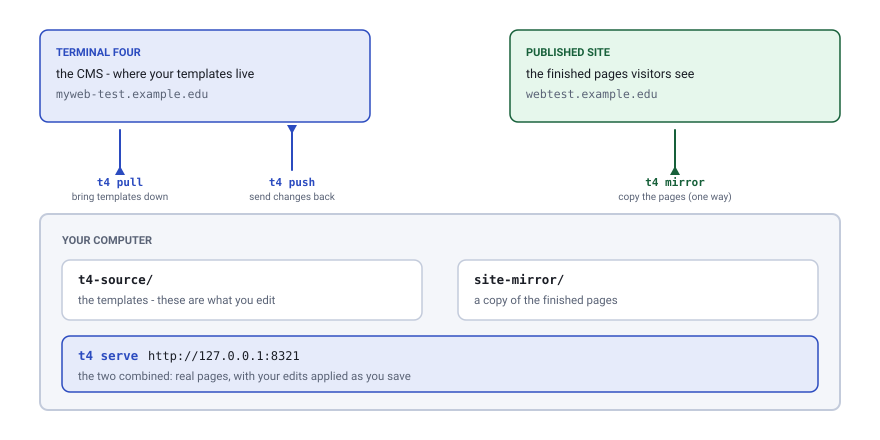
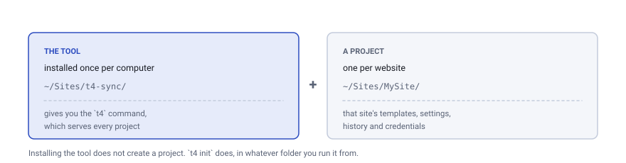
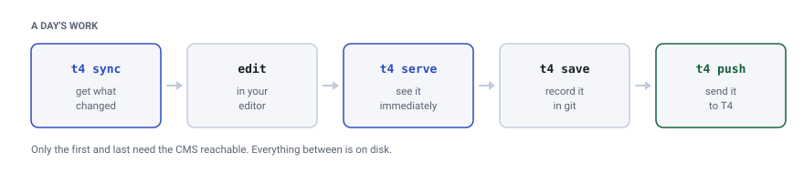
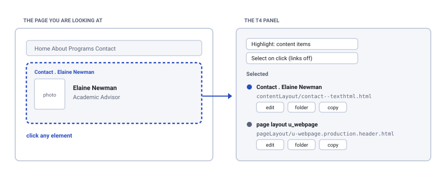
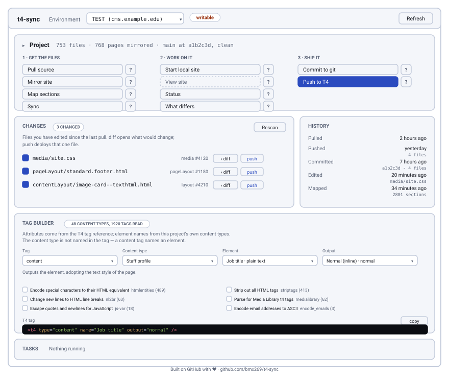
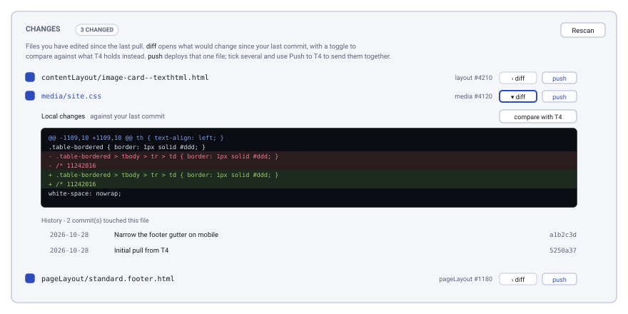
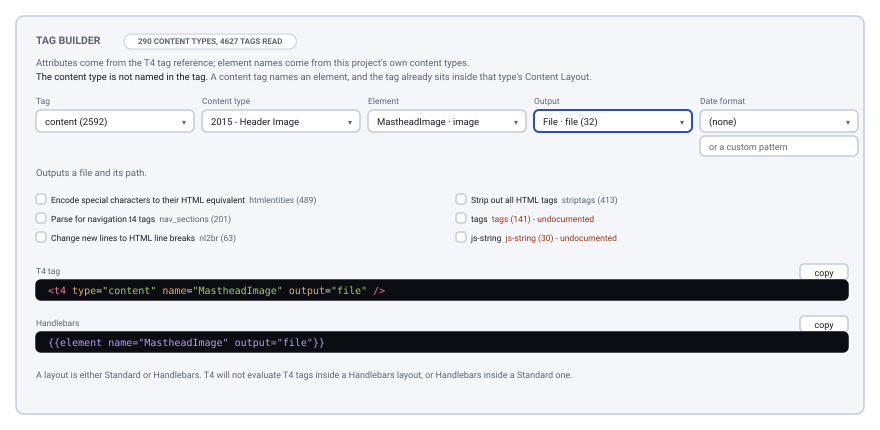

# t4-sync

**A T4 CMS Local Development Tool.**
Work on a Terminal Four site from your own computer: bring the templates down,
edit them in a normal editor, see the result immediately, and send them back
when you are happy.

Standard library only — no dependencies beyond Python 3.11+.

**[Documentation →](https://bmx269.github.io/t4-sync/)**

> An independent, unofficial tool. Not produced or endorsed by TERMINALFOUR
> Solutions Ltd, and not TERMINALFOUR software. "T4" and "TERMINALFOUR" are
> their trademarks, used here only to say what this works with.

## What it does

Terminal Four keeps your templates inside the CMS, and publishes finished pages
to a web server. Editing means clicking through the CMS, saving, publishing and
waiting to see what happened. This tool puts both halves on your machine so the
loop is a page refresh instead.

<picture>
  <source media="(prefers-color-scheme: dark)" srcset="docs/img/overview-dark.svg">
  
</picture>

Two different servers, and they can fail independently. The **CMS** holds the
templates (`t4 pull`, `t4 push`). The **published site** holds the finished
pages (`t4 mirror`). If either is behind a VPN, you need to be connected for
those commands — but not for day-to-day editing, which happens entirely on disk.

## Getting started

Two separate things get set up, and it helps to keep them apart:

<picture>
  <source media="(prefers-color-scheme: dark)" srcset="docs/img/setup-dark.svg">
  
</picture>

### 1. Install the tool — once per computer

You need **Python 3.11 or newer** and **git**. Both are free; if you do not
have them, install Python from [python.org](https://www.python.org/downloads/)
and git from [git-scm.com](https://git-scm.com/downloads).

Open a terminal (Terminal on a Mac, PowerShell on Windows) and run:

```sh
git clone https://github.com/bmx269/t4-sync.git
cd t4-sync
./install.sh                 # macOS and Linux
```

```powershell
git clone https://github.com/bmx269/t4-sync.git
cd t4-sync
.\install.ps1                # Windows
```

This keeps everything it needs inside the folder you just cloned and adds one
command, `t4`, to your system. It changes nothing else. If the installer says
the folder is not on your PATH, it prints the single line to fix that — copy
it, run it, and open a new terminal.

Check it worked:

```sh
t4 --version
```

Leave the cloned folder where it is; the `t4` command points into it. To get
later updates, `git pull` in that folder and run the installer again.

### 2. Set up a project — once per website

A project is just a folder. Make one wherever you keep your work, go into it,
and set it up:

```sh
mkdir ~/Sites/MySite
cd ~/Sites/MySite

t4 init                                        # creates the project here
t4 env add test https://myweb-test.example.edu # the CMS address
t4 token set test                              # paste your API token
```

The **token** is how the tool signs in to Terminal Four as you. Get one from
someone with CMS admin access, or generate your own in Terminal Four under
**Administration → User Management**. It is stored in this project only, never
committed, and nothing else on your machine can read it.

> **Already have a project repository?** Someone has done the above and shared
> it. Clone it instead of making a folder, then do only the `t4 init`,
> `t4 env add` and `t4 token set` steps — the templates arrive with the clone,
> so you can skip the next step entirely.

### 3. Bring the site down

```sh
t4 pull        # the templates, from the CMS
t4 serve       # fetches a copy of the published pages, then opens the site
```

`t4 pull` needs the CMS reachable; `t4 serve` fetches the published pages the
first time and then runs everything from disk. Behind a VPN, be connected for
both. The first `t4 serve` takes a few minutes — after that it starts instantly.

Your browser now shows the site at **http://127.0.0.1:8321**.

### 4. Make a change

Open any file under `t4-source/test/` in your editor — the stylesheets are in
`media/`, the page templates in `pageLayout/`, the component markup in
`contentLayout/`. Save it, and the browser refreshes by itself.

Not sure which file produced what you are looking at? The site you are serving
has a **T4** button in the corner. Open it, turn on **Select on click**, and
click anything on the page: it names the content type, the template and the
stylesheet behind it, each with a button to open that file in your editor.

### 5. Send it back

```sh
t4 st                             # what have I changed?
t4 save -m "Fix the footer gap"   # record it in version control
t4 push                           # send it to Terminal Four
```

`t4 push` shows you each change and asks before sending it. Nothing leaves your
machine without you saying yes.

### What next

Once set up, a day looks like this:

<picture>
  <source media="(prefers-color-scheme: dark)" srcset="docs/img/workflow-dark.svg">
  
</picture>


| You want to | Do this |
|---|---|
| Work without the terminal | `t4 app` — see below |
| Start work the next day | `t4 sync` then `t4 serve` |
| Know which file made a page | Open the **T4** panel on the served site |
| Undo something you sent | `git revert`, then `t4 push` again |
| Let the inspector name everything | `t4 sections` — slow, but once only |
| Work on production | Nothing: production is read-only until deliberately enabled |

## How it is organized

A **project** is any directory containing `.t4/config.json`, found by walking
up from the working directory — the way git finds `.git`. The tool is generic;
the configuration, the pulled source and the site mirror belong to the project.

```
your-project/
  .t4/
    config.json          environments and settings — commit this
    tokens/              API tokens — never committed, 0600
    rewrites.conf        serve-time URL rewrites
  t4-source/
    <env>/
      _manifest.json     file -> endpoint/id/field/hash, needed by push
      _raw/              every API response verbatim
      _backup/<stamp>/   pre-push snapshots
      pageLayout/        name.header.html, .footer.html, .stylesheet.css
      contenttype/ navigation/ list/ channel/
  site-mirror/<host>/    published site
  overrides/             shadows the mirror when serving
```

`t4 init` writes a `.gitignore` block covering tokens, raw responses, backups
and the mirror.

### Every setting, and its default

`t4 init` writes only `source_dir`, `mirror_dir` and `overrides_dir`; the rest
have defaults and are there when you want them. Nothing here is secret —
tokens live in `.t4/tokens/`, one file each, and are never written to this
file.

```json
{
  "source_dir": "t4-source",
  "mirror_dir": "site-mirror",
  "overrides_dir": "overrides",
  "default_environment": "test",

  "require_commit": true,
  "component_markers": null,
  "span_markers": null,

  "environments": {
    "test": {
      "base": "https://myweb-test.example.edu/terminalfour/rs",
      "label": "TEST",
      "published_url": "https://webtest.example.edu",
      "push_allowed": false,
      "require_commit": false,
      "language": "en",
      "root_section": null
    }
  }
}
```

| Setting | Default | What it does |
|---|---|---|
| `source_dir` | `t4-source` | Where pulled layout source lands |
| `mirror_dir` | `site-mirror` | Where `t4 mirror` saves the published pages |
| `overrides_dir` | `overrides` | Local-only files that shadow the mirror |
| `default_environment` | first alphabetically | Which environment a command uses without `--env` |
| `require_commit` | `true` | Whether `t4 push` refuses uncommitted files. Set per environment to override |
| `component_markers` | none | Extra patterns for the inspector to recognise as component boundaries |
| `span_markers` | none | Extra patterns the preview engine uses to align layout output |

Per environment:

| Setting | Default | What it does |
|---|---|---|
| `base` | — | The CMS Web Services endpoint, ending `/terminalfour/rs` |
| `label` | the environment name | What `t4 status` and the panel display |
| `published_url` | none | The site `t4 mirror` crawls and `t4 serve` proxies |
| `push_allowed` | `false` | Whether `t4 push` may write here at all |
| `require_commit` | the project setting | Whether a push must come from a commit |
| `language` | `en` | The language segment several API paths require |
| `root_section` | none | Where `t4 sections` starts walking |

The two that matter most are deliberately the cautious way round:
`push_allowed` is **off** until you turn it on, so a production instance
cannot be written to by accident, and `require_commit` is **on** unless you
turn it off.

## Commands

### Pull and push

```sh
t4 pull                     # the default environment
t4 pull --env prod
t4 pull --all               # every environment that has a token
t4 pull --only pageLayout
t4 pull --no-detail         # metadata only: fast, no source
t4 pull --binary            # also fetch binary media (images, fonts)
t4 pull --force             # overwrite files you have edited locally
```

A pull **will not overwrite a file you have edited** since the last pull. The
manifest records a hash of every file as pulled, which is what distinguishes
"you changed this" from "the remote changed". Protected files are listed at the
end of the run; `--force` discards them.

```sh
t4 sync                     # pull, then report both sides
t4 diff [paths...] [--show]
t4 save -m "why"            # commit the pulled source
t4 push [paths...] [--dry-run]
```

`sync` is the daily command: it refreshes, then tells you what changed in T4,
what is new or gone, and what you have edited locally but not pushed. It never
writes to T4.

`push` offers only files that genuinely differ, shows a diff, and asks per file
(`y`/`N`/`q`). Every record is snapshotted to `_backup/` before being modified.

**It tells you who moved.** The manifest records what each file looked like
when it was pulled, so "these differ" splits three ways:

| | |
|---|---|
| you changed it | the normal case — push it |
| **T4 changed it, you did not** | pushing would put the old version back, a silent revert. `t4 pull` first |
| **both changed it** | a conflict. Pushing discards whoever edited it in the CMS |

A conflict stops the push and names the files; `--ignore-conflicts` proceeds
and keeps your side. On a shared instance this is the likeliest way to lose
work with this tool, so it is refused rather than warned about. The idea is
borrowed from Salesforce DX source tracking, whose rule is that a deploy must
not silently overwrite what changed in the org.
Pushing is **disabled per environment by default** — set `"push_allowed": true`
in `.t4/config.json` for the environments you want writable, and leave
production off unless you mean it.

### Version control, before deploying

A push writes straight into the CMS database. T4 keeps its own per-record
history, but it lives behind the UI and says nothing about *why* a change was
made or what else went with it. So the record of a deployment is kept on this
side, in the repository the pulled source already sits in:

```sh
t4 save -m "Narrow the promo box gutter on mobile"
t4 push
```

`t4 save` stages the environment's pulled source and commits it. The message
it writes names the T4 record behind each file, because a reviewer looking at
`contentLayout/promo-boxes--texthtml.html` cannot otherwise tell which record
that is:

```
Narrow the promo box gutter on mobile

  t4-source/test/contentLayout/promo-boxes--texthtml.html  ->  layout #975973  (text/html)

T4-Env: test
```

**`t4 push` refuses to deploy a file that is not committed.** The check runs
after the comparison, so it names the files actually about to go out, not
everything that happens to be dirty in the tree.

**It is set per environment**, because the answer differs: test is where you
iterate, and a commit per experiment is friction you will route around;
production is where the record of what shipped matters most.

```json
"environments": {
  "test": { "push_allowed": true,  "require_commit": false },
  "prod": { "push_allowed": false, "require_commit": true }
}
```

An environment's own setting wins; a project-level `require_commit` is the
default for any that do not say; absent both it is on, because the safe
default is the one you have to opt out of. `--allow-dirty` skips it for a
single run. A project that is not a git repository is not blocked — the tool
predates this — but it says so rather than deploying untracked work silently.

Each successful push appends a line to `.t4/deployed.jsonl` recording the
file, the T4 record, and the commit it was deployed from, and `.t4/history.jsonl`
records what was pulled, pushed, committed and mirrored, and when. Both are
local to your checkout — `.t4/` is not committed — so they answer "what did
*this machine* do", which is the question they can answer honestly.

`t4 status` shows the repository state alongside everything else.

### What the repository tracks

**Only `t4-source/`.** `.t4/` holds the CMS URLs you work against, your API
token, and the local logs above. Committing it means a clone carries someone
else's environment, and eventually a credential however careful the ignore
rules are. `t4 init` writes a `.gitignore` that keeps it out, along with the
mirror and the raw API responses — all regenerable, and the mirror is large.

So a colleague starting from a clone does:

```sh
git clone <repo> && cd <repo>
t4 init                                  # their own .t4/
t4 env add test https://myweb-test.example.edu
t4 token set test                        # their own credential
t4 serve                                 # mirrors, then serves
```

The source is already there from the clone, so there is nothing to pull before
they can look at it — a pull only becomes necessary when T4 has moved on.

### The editing loop

```sh
t4 s                                      # start the local site (alias for serve)
# edit t4-source/<env>/media/site.css     — the browser refreshes on save
t4 st                                     # what is pending
t4 save -m "Tighten the footer spacing"   # commit it
t4 push                                   # deploy it
```

**You edit the pulled source directly.** A site's CSS and JS are Media Library
items, so `t4 pull` already brought them down, `t4 serve` serves those files
in place of the mirrored copies, and `t4 push` deploys them. One file: the one
you edit is the one you see and the one that ships.

`t4 serve` sets up what it needs. If there is no mirror yet it fetches one
from the environment's `published_url` before serving — so a fresh checkout is
`t4 serve` rather than `t4 mirror` then `t4 serve`. That first fetch needs the
published site to be reachable, which behind a campus network means the VPN;
afterwards everything is served from disk and nothing is needed but `--proxy`
for assets you chose not to mirror. `--no-setup` makes it fail instead, and
`--setup-limit N` caps the first crawl.

`serve`, `status` and `diff` have the short forms `s`, `st` and `d`.

`t4 edit` is for the rest — a mirrored page, a third-party script, anything
the pull does not cover and you want to experiment on locally. It copies the
file into `overrides/` at the right path so you do not have to reproduce a
deep one by hand; `--list` shows what is overridden, `--revert` drops one, and
a wrong path suggests near matches. It **refuses to override something already
pulled** and points at the pulled file instead; see
[One file, not two](#one-file-not-two).

`t4 serve` watches both `t4-source/` and `overrides/` and refreshes the
browser on save, via an injected server-sent-events listener. `--no-reload`
turns it off.

### Finding the source file

```sh
t4 layouts                    every published layout, its pages, its local files
t4 layouts about/admissions   just that page
```

`t4 serve` also reports it per page, in two forms — an overlay and
Drupal-style theme-debug comments in the served HTML:

```html
<!-- T4 DEBUG -->
<!-- PAGE LAYOUT: 'standard' #1180 -->
<!-- SOURCE FILES:
   x t4-source/test/pageLayout/standard.header.html
   x t4-source/test/pageLayout/standard.footer.html
-->
<!-- ASSETS (23, 1 overridden):
   x media/web/css/brand.css
   * media/web/css/site.css
   * not overridden. CSS and JS are Media Library items: edit t4-source/<env>/media/<name>
     directly - that file is served here and is what t4 push deploys.
-->
<!-- CHILD PAGES (25):
   basic_page: about, courses, news, events, ...
   standard: alumni, giving
-->
```

`--inspect comments` for comments only, `panel` for the overlay only, `both`
(the default), `off` for neither. The comments are added at serve time; files
under the mirror are never modified.

#### Content items named where they appear

T4 publishes an anchor for every content item it renders:

```html
<span id="d.en.4021"></span><!-- T4 CONTENT: #4021 'A promoted link' of type 'Promo boxes' -> t4-source/test/contenttype/promo-boxes.json -->
```

This is T4's own markup rather than a site convention, so it works on any
instance, and it carries the item's id — so the annotation names the specific
piece of content, not only its type. Requires `t4 sections`, which records the
content items as it walks (`--no-contents` skips them).

#### Components marked where they start

T4 does not delimit content items in published output. Many sites do comment
them from their own content layouts, and where that convention exists it can be
read back, so each component is marked at the point it begins:

```html
<!-- ct:322 Contact Footer --><!-- T4 COMPONENT: 'Contact footer' -> t4-source/test/contenttype/contact-footer.json -->
<div class="row ct-322" id="contact-bar">
```

Navigation objects too:

```html
<!-- n:Footer-Contact (273) --><!-- T4 NAVIGATION: 'Footer-Contact' -> t4-source/test/navigation/footer-contact-273.json -->
```

The site's own markers are left in place; the note is added after them. A
marker whose id is not in the local pull says so rather than pointing at the
wrong file.

**These conventions are per-site, not a T4 feature.** The defaults recognize
`<!-- ct:ID Name -->`, `<!-- ct-ID Name -->`, `<!-- content type: Name -->` and
`<!-- n:Name (ID) -->`. Set `component_markers` in `.t4/config.json` for other
conventions — a list of `[regex, endpoint]` pairs, where the regex has an `id`
group, a `name` group, or both:

```json
{
  "component_markers": [
    ["<!--\\s*component:(?P<name>[^>]+?)\\s*-->", "contenttype"]
  ]
}
```

A content layout's *template* still cannot be linked, because the REST API does
not expose Content Layouts at all — the link is to the content type's
definition.

#### Exact resolution

```sh
t4 sections --root <site-root-id>     # walk the tree, record each assignment
```

T4 knows exactly which layout each section uses — every section carries, per
channel, `{"pageLayout": 1100982, "inheritedPageLayout": 1100998}`. With that
pulled, the inspector reports the real assignment instead of inferring it:

```html
<!-- NOTE: assigned in T4 to section 228911 (Applied Business Technology) -->
<!-- SOURCE FILES:
   x t4-source/test/pageLayout/u-webpage.production.header.html
-->
```

Three requests per section with content items, two without, so it is a
separate, opt-in pull. It is resumable:
`--limit` stops early and re-running continues from the cache. Without it, the
inference below is used instead.

#### How the layout is identified when there is no section map

T4 publishes a layout *name* into nearly every page, but the name need not
identify one layout: a site can publish `basic_page` from any of several
`basic_page.*` layouts. Rather than asking for a mapping, the layout is
identified from the page itself:

| Signal | What it does |
|---|---|
| `t4-layout-id` | Exact, when the page carries it (often it does not) |
| **Alignment** | A layout's literal markup must appear, in order, in the page. One that did not produce the page usually fails outright |
| **Tag ids** | Among survivors, score the ids that *differ* between them. T4 layouts commonly echo media and navigation ids into the output |

On a real site this resolved 297 of 300 pages; the other three carry no meta
tag at all. Where two layouts are genuinely indistinguishable -- identical
literals, identical tags -- it says so instead of picking one:

```html
<!-- NOTE: indistinguishable from the published page: basic_page.a, basic_page.b -->
```

### The inspector

`t4 serve` injects a small **T4** badge in the corner of every page. Expand it
and it answers "what rendered this, and what do I edit":

<picture>
  <source media="(prefers-color-scheme: dark)" srcset="docs/img/inspector-dark.svg">
  
</picture>

Click something on the page and the panel narrows to just what produced it —
the component, its template, the page layout around it — each with a button to
open that file in your editor or show it in Finder. While **Select on click**
is on, links do not navigate, so clicking a menu item tells you about it
instead of taking you away.

```
Page layout   standard  #1180
              pageLayout/standard.header.html      [edit]
              pageLayout/standard.footer.html      [edit]
Assets        23, 1 overridden
              media/web/css/site.css           [edit]
              media/web/css/brand.css        [editing]
              ...
```

T4 publishes `<meta name="t4-layout">` and `<meta name="t4-layout-id">` into
every page. The id is matched against the pull manifest, so the panel names the
exact file on disk rather than leaving you to guess which of 58 layouts with
names like `basic_page.production` and `standard_alt_no_menu` produced the page.
Layout *names* are not reliably unique after slugging; the id is.

Every file row carries **edit**, **folder** and **copy**: open it in your
editor, show it in Finder or Explorer, or copy the path. A browser cannot
launch an application, so the serving process does it — and refuses any path
that resolves outside the project. Assets already overridden are highlighted.

A **Content** section lists what the page is made of, grouped by content type,
with the files behind each one:

```
Content       5 type(s), 32 item(s)
  ● Contact                                           x25
      contentLayout/contact--texthtml.html      text/html   [path]
      contentLayout/contact--textrss.html       text/rss    [path]
      contenttype/contact.json                              [path]
      Main reception · Second reception · ...
  ● Page Content                                       x3
      ...
```

Content types are field definitions; the markup they render lives in their
**Content Layouts**, so that is what the panel points at. Clicking an item
scrolls the page to it and flashes it. This comes from the `d.en.<id>` anchors
T4 publishes for every content item it renders — T4's own markup, not a site
convention — matched against `t4 sections`, so it works on any instance.

**Highlight** outlines what is on the page, coloured by type, with a legend:

| | |
|---|---|
| `content items` | every content item, from T4's own anchors |
| `marker components` | components the site comments in its own layouts |
| `everything` | both |

The colour is derived from the type name, so the same component is the same
colour on every page, and the panel's swatches match the outlines. **labels**
turns the name badges off when they get in the way of seeing the layout. Both
settings are remembered per browser.

It works from the marker comments already in the DOM — no markup is injected
into the page, which would risk landing somewhere invalid like `<head>` or
inside a `<table>` and changing how the page renders. A component that resolves
to an element with no height climbs to the nearest ancestor that occupies
space, and two components sharing one element have their labels combined rather
than one overwriting the other.

If a page has no `t4-layout` meta, or the layout has not been pulled yet, the
panel says so rather than showing nothing. `--no-inspect` turns it off.

**One file to edit, and it is the one that deploys.** A site's CSS and JS are
Media Library items whose content T4 serves verbatim, so the file pulled into
`t4-source/media/` is the same bytes the site publishes. `t4 serve` serves that
file in place of the mirrored copy, so:

```sh
t4 serve
# edit t4-source/<env>/media/site.css   -> the browser reloads
t4 diff media/site.css                  -> shows the change
t4 push media/site.css                  -> deploys it
```

No second copy to keep in step, and no manual upload.

#### One file, not two

`t4 edit` refuses to override something that has been
pulled, and points at the pulled file instead. An override of a pulled file is
a second copy that serves identically and silently never deploys — you can
lose an afternoon to it while the browser shows your change the whole time. If
you already have one:

```sh
t4 edit --promote media/web/b3/css/site.css   # move it into the source, drop the copy
```

`t4 serve` also reports any override that shadows pulled source at startup,
since refusing to make new ones does not find the ones already there.

`overrides/` remains for shadowing a mirrored file you have *not* pulled — a
quick experiment on something that is not Media Library source. Overrides are
local-only and are never deployed; `--no-media-source` turns the behaviour off
if you want the mirror served as-is.

### Content layout edits

Editing a content layout shows up too, applied to every item on the page that
uses it — a page with twenty Contact items gets all twenty. Nothing is written
into the mirror; the splice happens on the way out, so mirrored files stay
byte-identical to what T4 published.

It needs `t4 sections`, because an edit is only applied inside the output of
items of its own type. Without that check a short layout's literal markup
matches wherever it happens to occur, and a false match does not merely fail
to help — it rewrites part of a page that layout never produced.

**Where it cannot be faithful, it does nothing.** A content layout renders
once per item, and its optional fields are empty for some of them; a tag that
produced no output cannot be told apart from any other that produced none, so
re-emitting would drop real content — names, ids, links. Those occurrences are
left exactly as published and the page says so in a comment. On a real site
this lands for roughly half the occurrences: simple structural layouts preview,
field-heavy ones like a staff profile do not.

### Previewing a layout edit

Edits to a pulled page layout show up on the local site without a publish
cycle:

```sh
t4 serve
# edit t4-source/<env>/pageLayout/<name>.footer.html
# reload - the change is there
```

This is not rendering. T4 tags are evaluated by T4, and nothing local can run
them. But the mirrored page *is* the result of running them, so the two can be
aligned:

```
source:   <lit A>  <t4 .../>  <lit B>  <t4 .../>  <lit C>
output:   <lit A>  ...????..  <lit B>  ...????..  <lit C>
```

The literal markup appears verbatim in the published page, so whatever sits
between those anchors is what the tags produced. Capture it, then re-emit the
*edited* source with it substituted back. Wrapping a tag in a div, changing a
class, adding or reordering markup — all apply locally.

A no-op edit reproduces the page byte-for-byte; that invariant is tested.

Or as a diff, without a browser:

```sh
t4 preview                     # the home page
t4 preview about/admissions
t4 preview --out /tmp/x.html   # write the previewed HTML instead
```

```diff
index.html
  layout  standard  #1180
  edited  pageLayout/standard.footer.html

--- published
+++ with local edits
-<!-- n:Footer-Contact (273) -->
+<div class="footer-contact-bar-ts"><!-- n:Footer-Contact (273) -->
```

This is not a substitute for T4's own Preview, which is authoritative. The
REST API exposes no preview or publish operation (checked on 8.4.3 and 8.4.5),
so seeing the rendered result still means previewing or publishing in T4.

#### What it will tell you it cannot do

**A tag with no published output** — a new tag, or an existing one pointed at a
different id — has never produced anything to reuse:

```html
<!-- T4 PREVIEW: <t4 type="navigation" id="99" /> has no published output to
     reuse, so it cannot be previewed -->
```

**Tags whose output cannot be told apart.** Where several tags sit together
with no literal markup between them, their output is one undivided run. If the
site's layouts bracket a tag's output with comments, that tag can be isolated
(the defaults recognize `<!-- n:Name (ID) -->…<!-- /n:ID -->` and the `ct:`
equivalent; set `span_markers` in `.t4/config.json` for other conventions).
Otherwise, placing markup around one tag of the run would silently wrap all of
them, so it says so:

```html
<!--   WARNING: markup was placed around tags whose individual output cannot be separated -->
<!--   affected: <t4 type="navigation" id="276" />, <t4 type="media" id="1094476" ... -->
<!--   what you see wraps the whole run, which is not what T4 will publish -->
```

That warning is the point. A preview that quietly differs from what T4 will
publish is worse than no preview.

`--no-preview` serves the mirror exactly as published.

### Testing a tag

```sh
t4 fixtures                                   # content types you can render
t4 fixtures "Staff profile"                   # its layout, filled in
t4 fixtures "Staff profile" --tags new.html   # tags you are writing
```

The preview in [Previewing a layout edit](#previewing-a-layout-edit) reuses
output T4 has already published, so it can only show a layout that has
rendered something. That rules out the case you most want help with: tags you
are adding now, for a content type nobody has filled in yet.

The element types make a way around it. A Content Type says what each of its
elements is — plain text, HTML, date, list, link, image — so a plausible
value can be invented for each one and substituted into every `<t4>` tag that
names it. What comes back is your markup with content in it: enough to see it
nest correctly and the CSS apply, which is the question being asked.

`--tags` renders a fragment rather than a pulled layout, so a handful of tags
can be tried before they go anywhere near the CMS. `-` reads standard input:

```sh
echo '<h1><t4 type="content" name="Full name" /></h1>' \
  | t4 fixtures "Staff profile" --tags -
```

#### Deciding what goes in

Invented values are fine for seeing a shape, but a test needs particular
values — a title long enough to wrap, an element left empty to see what
happens without it, the exact string a bug was reported against. `--values`
takes a JSON file of `{element name: value}`, and `null` empties an element:

```json
{
  "Full name": "A name long enough to wrap onto a second line",
  "Biography": null
}
```

```sh
t4 fixtures "Staff profile" --tags card.html --values wrapping.json
```

Anything not named keeps its invented value, so a file only has to say what
the test is about. A name that is not an element of that type is an error
rather than a silent omission, because a dropped value looks exactly like a
layout losing it.

The invented values are English rather than lorem ipsum, because English
makes a broken layout obvious at a glance where Latin hides it. When that is
the wrong trade — a screenshot for a client, or a layout being judged on
its typography rather than its wording — `--lorem` swaps it:

```sh
t4 fixtures "Staff profile" --lorem
```

Only text changes. A date is still a date and an image still an image,
because Latin would not make those any more obviously placeholder than they
already are. The text is the same on every run, so one rendering can be
compared against the one before it, and anything named in `--values` still
wins.

Add `--css` for the site's own stylesheets — repeatable, and without it you
are looking at unstyled markup. `--out` chooses where the HTML goes; the
default is `.t4/fixtures/`, which is not committed.

#### What it is not

**It is not T4's renderer and does not pretend to be.** Modifiers are not
applied, `navigation`, `media` and `meta` tags cannot be filled without the
CMS, and a Programmable Layout will not run. Every page says so across the
top, and anything that could not be filled is left visibly marked with the
original tag inside it, rather than blanked — so the output never looks more
finished than it is.

The run reports the same thing in the terminal, including two mistakes worth
catching early: a tag with no `type=`, and a tag naming an element the
content type does not have, which usually means a layout assigned to the
wrong type.

### Checking the local copy is faithful

```sh
t4 compare                      # the home page
t4 compare about/admissions
t4 compare --local http://127.0.0.1:8331
```

Fetches the page from the published site and from the local server, removes
everything this tool injected, and diffs the two. The local copy is assembled
from a mirror, plus local edits, plus captured tag output -- several places for
a difference to creep in unnoticed.

Everything injected is fenced with `<!--T4SYNC:BEGIN-->` / `<!--T4SYNC:END-->`
so it can be removed exactly. Stripping by pattern does not work: the
annotations themselves contain `>` and `->`.

Differences are explained rather than reported as failures -- local layout
edits not yet published will show up, and so will content that changed in T4
since the mirror was taken.

### Checking an instance

```sh
t4 doctor                   # read-only probe of the configured environment
t4 doctor --env prod
```

Reports the T4 version, token expiry, and whether each endpoint responds —
including whether the fields the tool extracts source from are still present,
since a DTO change between releases would otherwise show up as a silently
empty pull rather than an error.

Run this first against any instance you have not used before. T4's REST
surface varies by version and deployment, so probing beats assuming.

### Local copy of the site

```sh
t4 mirror                   # uses the environment's published_url
t4 mirror https://webtest.example.edu/
t4 serve                    # http://127.0.0.1:8321/
```

The mirror crawls the **published site over HTTP** — it is a separate thing
from `t4 pull`, which reads layout source from the CMS API. So it needs the
published host to be reachable, which behind a campus network means the VPN.
Once the mirror is on disk, `t4 serve` needs nothing but the files (and
`--proxy`, if you left assets unmirrored).

The mirror saves files **verbatim**. They are byte-identical to what T4
published, so markup copied out of them pastes straight back into a layout.
URL rewriting happens at serve time instead.

**Rules for your own channels are derived automatically** from the
`published_url` of each configured environment. T4 writes absolute URLs into
published pages, and they usually point at production even in a test channel —
hosts that are typically unreachable from a workstation. Without rewriting them
the stylesheets never arrive and the page renders unstyled, which looks like a
rendering fault rather than a missing asset.

Add anything else to `.t4/rewrites.conf`; file rules are applied before the
derived ones:

```
# <regex><TAB><replacement>
https?://legacy\.example\.edu/	/
```

Documents (PDF, Office) are skipped by default; `--include-documents` keeps
them.

**Asset proxy.** Anything missing locally is fetched from the live site on
demand and cached, like `stage_file_proxy`. Images and documents dominate a
mirror's size while contributing nothing to front-end work, so you can mirror
pages, CSS and JS and still see a complete site.

```sh
t4 serve                        # proxies to the environment's published_url
t4 serve --proxy https://www.example.edu
t4 serve --no-proxy             # serve only what is mirrored
t4 serve --no-proxy-cache       # proxy without writing into the mirror
```

Files in `overrides/` shadow the mirror for anything the pull does not cover.
CSS and JS do not belong here — they are Media Library items served straight
from `t4-source/`, so you edit those directly and they deploy. Responses are
sent `Cache-Control: no-store`, so a plain reload picks up edits.

## The web UI

```sh
t4 app                      # opens http://127.0.0.1:8320/ in your browser
```

Everything in [Commands](#commands), without the terminal. One command opens
it, and it runs the same `t4` commands behind the buttons.

<picture>
  <source media="(prefers-color-scheme: dark)" srcset="docs/img/app-dark.svg">
  
</picture>

**Every button runs the real command as a subprocess.** Nothing here
reimplements a command, so nothing here can quietly disagree with one: the
per-environment `push_allowed` flag, the uncommitted-source gate and the
pre-push backups all still apply, because the code enforcing them is the code
being run. A pull-only environment shows its push button disabled, but the
refusal underneath is the same one the CLI gives.

### Opening it

`t4 app` prints a URL and opens it. The environment picker in the header
chooses which one everything below acts on, and the pill beside it says
whether that environment is writable. **Refresh** re-reads the project without
running anything.

On macOS and Windows there are double-clickable launchers in `launchers/`.
Copy the one for your platform into your project directory — the one holding
`.t4/` — and double-click it. It does what `t4 app` does.

### The three stages

The Project card groups the actions in the order a session runs in. Each one
has a **?** beside it that says what it does and what it needs, so the panel
can be read without this page open.

**1 · Get the files**

| Button | What it does |
| --- | --- |
| Pull source | Downloads the templates — page layouts, content layouts, content types, and the Media Library CSS and JS. Needs the CMS reachable, so the VPN if you use one. It will not overwrite a file you have edited since the last pull. |
| Mirror site | Crawls the *published* site and saves the finished pages, so there is something real to look at. A different server from the pull. |
| Map sections | Walks the site tree recording which layout each section uses and which content sits in it. Slow — a few thousand requests — but it resumes where it left off and is only needed occasionally. |
| Sync | Pulls, then reports what changed on each side. Never writes to the CMS. The usual way to start a session. |

**2 · Work on it**

| Button | What it does |
| --- | --- |
| Start local site | Runs the site on your machine from the mirrored pages, with your edits applied and the inspector switched on. It keeps running until you stop it. |
| View site | Opens the local site in a new tab, once the server has reported its address. |
| Status | What is pending, grouped by kind, with the repository state. Read only. |
| What differs | Compares every file against what the CMS holds right now. Read only, and slow over a VPN: one request per record. For a single file, use **diff** in the Changes list instead. |

**3 · Ship it**

| Button | What it does |
| --- | --- |
| Commit to git | Records your edits in the repository, with a message naming the CMS record behind each file. Whether a push requires this first is set per environment in `.t4/config.json`. |
| Push to T4 | Sends the ticked files, backing up each record first. Only writable environments accept it. |

### Choosing what to deploy

<picture>
  <source media="(prefers-color-scheme: dark)" srcset="docs/img/changes-dark.svg">
  
</picture>

Changes lists what you have edited since the last pull, or have not committed
yet — either counts, and the row says which. Each row names the file and the
T4 record it maps to.

**diff** opens what changed since your last commit, with a toggle to compare
against what T4 holds instead; the first is instant and the second costs one
request, which is why the local one is the default. Under it, every commit
that touched the file, and clicking one shows what it did.

**push** deploys that single file. Tick several and use **Push to T4** to send
them together. Nothing is sent that you did not tick.

**Rescan** re-reads the working tree. It is only needed when something changed
the files from outside — a `git checkout`, say — because an edit made in your
editor is noticed on its own.

### History

The History panel says when each kind of thing last happened: pulled, pushed,
committed, edited, mapped. Beneath it, **Recent activity** is the running log
in order, so "did that push go through?" is answerable without reading the
output pane.

It comes from `.t4/history.jsonl`, which this machine appends to and nothing
else reads. It is not committed.

### Building a tag

<picture>
  <source media="(prefers-color-scheme: dark)" srcset="docs/img/tagbuilder-dark.svg">
  
</picture>

Writing a T4 tag by hand means remembering an element's exact name, which
`output` value that element type takes, and which modifiers to apply. Getting
any of them wrong fails at publish time, which is a slow way to find a typo.

Attributes come from the [T4 tag
reference](https://docs.terminalfour.com/documentation/page-management/generate-t4-tags/)
— each tag type with the attributes it actually accepts — and element names
come from this project's own Content Types. The builder emits only what the
chosen type takes, and says what it dropped and what is missing rather than
producing markup that looks right.

Each output explains itself in the documentation's wording and brings the
fields it needs: `format` for selective output, `layout` for a repeater, `info`
for a content owner. Modifiers read as what they do, with the identifier and
this project's usage count beside them, and anything the reference does not
list is marked. Both syntaxes come back together, with a note wherever
Handlebars has no equivalent.

**The content type is not named in the tag.** A content tag names an element,
and the tag already sits inside that type's Content Layout, so T4 knows which
type it is rendering. The picker is there to find the element name.

It composes only. T4 evaluates tags at publish time and nothing local can.

### Tasks and output

Tasks run side by side, so a pull does not stop you committing, and the local
site can stay up throughout. What cannot overlap is two commands touching the
same thing: a second pull waits for the first, because both write the same
files. The Tasks strip shows what is running and what it is waiting on.

Output streams into the pane below it as each command writes it — the same
text the CLI would print, not a summary of it. **Stop** ends a running
command.

### What it will not do

Two commands are deliberately absent: `t4 env` and `t4 token`. Setting an
environment's URL or storing a credential is a deliberate act that belongs in
a terminal, not somewhere a mis-click can reach. `t4 init` is absent for the
same reason.

**The URL carries a one-time token**, minted when the command starts. Binding
to loopback is not on its own a boundary — any page in any browser tab can
POST to `127.0.0.1` — so without the token every request is refused. Open the
URL the command prints rather than typing the address by hand, and treat the
URL as the credential it is.

## What this does not do

**It does not render T4 tags or Handlebars.** Nothing local can. `<t4 .../>`
tags, Handlebars expressions and Programmable Layouts are evaluated by T4's own
publish engine, in Java, against the CMS database. There is no standalone
renderer, and T4's helpers (`{{element}}`, `{{media}}`, `{{sectionName}}`, the
whole set) are proprietary to that engine.

So the two halves of this tool hold different things, and neither is a
substitute for the other:

| | What it holds | Tags in it |
|---|---|---|
| `t4 mirror` + `t4 serve` | Published **output** | Already evaluated — real HTML |
| `t4 pull` | Layout **source** | Unevaluated — `{{...}}` as literal text |

The practical consequence: a mirror is the right place to work on CSS, JS and
markup structure, because it is exactly what a visitor's browser receives. It
is the wrong place to test layout logic. Open a mirrored page and the template
is already resolved; open a pulled `.hbs` file in a browser and you see
`{{sectionName}}` printed on the page.

**Layout logic still has to be tested in T4** — Preview, Direct Edit, or a
staging channel. The loop this tool shortens is the front-end one: edit CSS or
JS in `overrides/`, reload, see it against real published markup, with no
publish cycle. The loop it does not shorten is changing a layout's logic.

What it does give you for layout work is version control, diffing and review:
you can see what changed in a layout, who changed it, commit it with
[`t4 save`](#version-control-before-deploying) and push a reviewed change —
you just cannot render it locally first.

## Things that will bite you

Verified against live T4 **8.4.3** and **8.4.5** instances. 8.4.4 is untested;
its release notes record no changes to the endpoints used here. Run `t4 doctor`
to confirm against yours.

**Some resources need a `{language}` path segment**, and omitting it returns
500 — the same answer as a route that does not exist. This hides whole
resources: Content Layouts are at `/layout/contenttype/{id}/{language}`, and
media at `/media/{id}/{language}`. Both looked absent for a long time because
they were requested without it.

**Endpoint names are case-sensitive and inconsistent.** `/pageLayout` is
camelCase; `/contenttype` is not. A wrong case returns **500** — identical to
an unrouted path — so a typo is indistinguishable from "this endpoint does not
exist". The verified set is in `src/t4sync/endpoints.py`. Do not tidy them.

**`/list` ignores its path segment.** `/list` alone returns 500;
`/list/<anything>` returns every list. The `1` in `list/1` is a placeholder.

**T4 stores CRLF.** All file IO uses `newline=""` to disable Python's
universal-newline translation. Without it every CRLF file looks modified and a
push would rewrite layouts with mangled line endings.

**A 500 is not evidence that a resource does not exist.** Content Layouts were
written off twice on that basis — about 30 route spellings were tried, all 500,
and the conclusion recorded here was "not exposed by the REST API". The cause
was the missing `{language}` segment above. They are pulled and pushed like
anything else. Check the published spec before concluding an endpoint is
absent.

**8.4.5 deprecates the XML Web Services payload** in favour of JSON. This tool
only ever speaks JSON, so that deprecation does not affect it. 8.4.5 also
reverts a Repeater API change made in 8.4.4, which may alter content type
responses between those two releases; records are written whole, so a field
change shows up as a diff rather than a failure.

**Tokens come from the UI.** Administration → User Management → generate an API
token. `/rs/authorise` returns 500 on at least one 8.4.3 instance, so tokens
cannot reliably be minted from a username and password.

**The network path to a CMS is often a VPN and often unreliable.** Transport
failures are retried with backoff; HTTP statuses are not, since the server
answered.

## Development

```sh
python3 -m unittest discover -s tests
```

The tests need no network and no T4 instance.

## Licence and trademarks

Copyright © 2026 Trent Stromkins.

Apache License 2.0 — see [LICENSE](LICENSE) and [NOTICE](NOTICE).

Use it, change it, ship it, including commercially. Keep the copyright notice
and the NOTICE file, and say what you changed. The licence includes an express
patent grant from contributors.

### Not affiliated with TERMINALFOUR

**This is an independent, unofficial tool.** It is not produced, endorsed,
sponsored, supported, reviewed or approved by TERMINALFOUR Solutions Ltd, and
it is not TERMINALFOUR software.

"TERMINALFOUR", "Terminalfour" and "T4" are trademarks of TERMINALFOUR
Solutions Ltd, used here only to identify the software this tool works with.
No affiliation or endorsement is claimed or implied.

It talks to a TERMINALFOUR instance through its published Web Services API,
and contains no TERMINALFOUR source code and no content from any customer
site. **Support comes from this project, not from TERMINALFOUR** — please do
not raise issues about it with them.

It can write to a CMS, and can therefore change content. Using it against an
instance is your responsibility under whatever agreement governs that
instance. The software is provided **"AS IS", without warranties or
conditions of any kind** — see sections 7 and 8 of the LICENSE.
